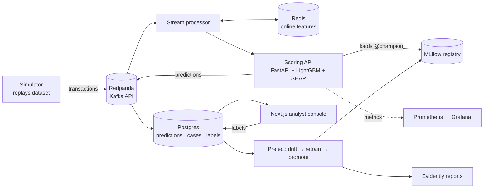

# FraudShield

**Real-time card-fraud detection with a complete MLOps loop.** It streams transactions, keeps
behavioural features fresh in Redis, scores each transaction in milliseconds with explanations,
gives analysts a review queue, and retrains itself when the data drifts.

> 🚧 Work in progress. See [docs/PLAN.md](docs/PLAN.md) for the roadmap and [docs/PROGRESS.md](docs/PROGRESS.md) for status.

## Architecture


Details: [docs/ARCHITECTURE.md](docs/ARCHITECTURE.md) · Data: [docs/DATA.md](docs/DATA.md)

## What makes it more than a Kaggle notebook
- **Point-in-time correct features**, shared by training and serving, with a parity test proving they match (no training/serving skew)
- **Time-based evaluation** with PR-AUC, recall at fixed FPR and cost-based thresholds instead of accuracy
- **Streaming** through a Kafka-compatible broker at configurable throughput
- **Champion/challenger** promotion through the MLflow model registry, triggered by **drift detection**
- **Human in the loop:** analyst decisions become training labels

## Results
_Filled in as phases complete. Every number must be reproducible with a command in this README._

| Model | PR-AUC | Recall @ 1% FPR | Expected cost | p99 scoring latency |
|---|---|---|---|---|
| Rules baseline | | | | |
| Logistic regression | | | | |
| LightGBM (stateless features) | | | | |
| LightGBM (+ behavioural features) | | | | |

## Quick start (Windows PowerShell)
```powershell
uv sync
uv run pytest -q
docker compose up -d                 # Redpanda (+ console at http://localhost:8080), Redis, Postgres
```
Dataset download: [docs/DATA.md](docs/DATA.md). Everything you need: [docs/NEEDS.md](docs/NEEDS.md).

## Project docs
[PLAN](docs/PLAN.md) · [NEEDS](docs/NEEDS.md) · [DATA](docs/DATA.md) · [ARCHITECTURE](docs/ARCHITECTURE.md) · [PROMPTS for Claude Code](docs/PROMPTS.md) · [decisions](docs/decisions.md) · [PROGRESS](docs/PROGRESS.md)

## Disclaimer
Trained on synthetic data (the Sparkov simulator). Results show the engineering approach; they do not describe real-world fraud performance.

## License
MIT
